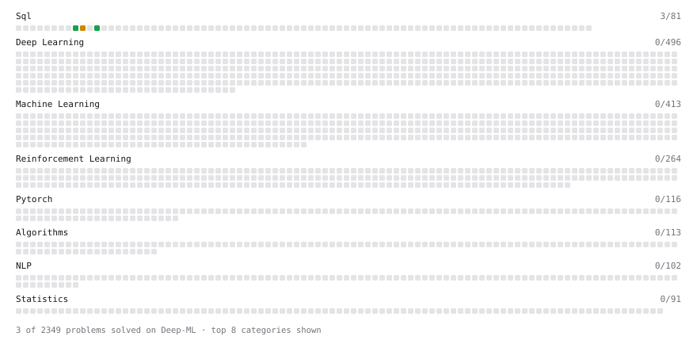

# Deep-ML

My machine learning practice from [Deep-ML](https://www.deep-ml.com). Every solution here was written by hand.

**3** solved · 3 problems · 0 labs · 0 math

[**Browse the interactive portfolio**](https://hoanganhtu0922.github.io/deep-ml/) to replay this filling in over time.

## Problems

| | Difficulty | Solved | |
| --- | --- | --- | --- |
| [Delete Duplicate Emails Keeping One](https://www.deep-ml.com/problems/1112) | easy | 2026-11-18 | [solution](problems/1112-delete-duplicate-emails-keeping-one) |
| [Your first JOIN](https://www.deep-ml.com/problems/1109) | easy | 2026-11-18 | [solution](problems/1109-your-first-join) |
| [Nth-Highest Salary with Ties and NULL](https://www.deep-ml.com/problems/1110) | medium | 2026-11-19 | [solution](problems/1110-nth-highest-salary-with-ties-and-null) |

---

_This file is regenerated by Deep-ML on every push._
